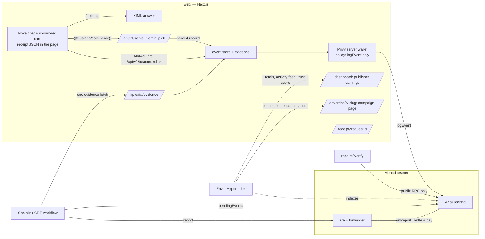

# Aria Clearing

**Clearing for sponsored AI answers: every sponsored line has a receipt, verified by Chainlink, settled on Monad.**

AI apps have large free tiers and no way to earn from them. Aria lets an independent AI app show a disclosed,
sponsored recommendation inside an answer when the user has buying intent. Aria Clearing is the trust and
settlement layer underneath: it turns each sponsored line into a public receipt anyone can verify from Monad
alone, and it pays the app only after a Chainlink CRE workflow has checked the evidence.

Track: **Trust, Identity & AI Infrastructure** (Metropolis hackathon).

- Live app: https://web-production-95cf9.up.railway.app
- Contract (Monad testnet, source verified): [`0x431e97E2EB23ac06C9f807cC8DCe54499C1bDC7B`](https://testnet.monadvision.com/address/0x431e97E2EB23ac06C9f807cC8DCe54499C1bDC7B)
- Indexer (Envio Cloud, GraphQL): https://indexer.dev.hyperindex.xyz/eca926f/v1/graphql
- Publisher SDK on npm: [`@trustaria/core`](https://www.npmjs.com/package/@trustaria/core),
  [`@trustaria/react`](https://www.npmjs.com/package/@trustaria/react)
- Demo video: _link added at submission_

Words used below: the **publisher** is the AI app that shows the sponsored line (Nova, `/ai-chat`, in this demo);
the **advertiser** is the brand whose claims it cites; a **receipt** is the onchain record of one sponsored line;
an event is **verified** when the CRE workflow released it and **rejected** when it refunded it.

## Try it in two minutes

The live site is one Next.js app with a demo bar on every page: `/` is the overview, `/ai-chat` is Nova (the
publisher), `/dashboard` is Aria's publisher dashboard, `/advertise` is Aria's advertiser console, and
`/receipt/<requestId>` is a receipt.

1. Ask [Nova](https://web-production-95cf9.up.railway.app/ai-chat) a buying question, e.g. "Is an e-bike worth
   it for a 12 km commute?". The answer streams from KIMI; a sponsored card follows it.
2. Click **Why this ad?** on the card to open its receipt: the sentence, the claims it cites, and its onchain
   status.
3. Settlement runs every 10 minutes (a scheduled GitHub Action runs the Chainlink CRE workflow; GitHub's schedule
   is best effort, so a run can be late). After the next run the receipt says **Verified** and the
   [publisher dashboard](https://web-production-95cf9.up.railway.app/dashboard) shows it paid: 80 % to the app,
   20 % Aria's fee.
4. Launch your own campaign in the
   [advertiser console](https://web-production-95cf9.up.railway.app/advertise): paste a website, KIMI drafts the
   claims, test funds are added to your embedded wallet, and your wallet escrows the budget.

The dashboard and the console sign in with an email and a one-time code (Privy). Both sign-in screens show a
shared test account whose code is fixed, so no email is sent. Use it for the dashboard: on the live site it is
the publisher that Nova's events are credited to (connecting another account as the publisher is a demo control
behind `ARIA_DEMO_KEY`, so a new email sees an empty dashboard). For the console any email works; launches and
test funds are counted per account, so use your own email for step 4.

## The receipt

Every sponsored line moves through one lifecycle, and every step is on Monad:

```
issued (card rendered) → logged (impression / click) → verified · paid   or   rejected / disputed → refunded
```

"Verified" means the event passed every check before any money moved. Aria logs an event only for a request it
served (the card's beacon also carries a token Aria signed); then the Chainlink CRE workflow checked the evidence
against the settlement rule: an impression in view for 1 s at 50 % or more (the MRC viewability baseline), a click through Aria's
redirect. The rule is one pure function inside the workflow, so stronger fraud checks plug into the same
settlement path without changing the contract.

A receipt binds three things together:

1. **The exact sentence the AI showed.** It is emitted in `EventLogged`; the contract hashes it itself.
2. **The advertiser's approved claims.** They are emitted in `CampaignCreated` with their hash; the sentence cites
   them by number, and the receipt page highlights the cited ones.
3. **The money.** The price is reserved from the advertiser's escrow when the event is logged and paid to the
   app when the event is verified.

Nova also embeds the receipt in the page, beside the card, so any extension, crawler or other app can find it:

```html
<script type="application/json" data-aria-receipt>
  {"chainId":10143,"contract":"0x…","requestId":"req_…","campaignId":"0x…","claimsHash":"0x…","rationaleHash":"0x…"}
</script>
```

The embedded `rationaleHash` is computed from the sentence the card renders, before anything is logged. Its
"Why this ad?" link carries the same values, `/receipt/<requestId>?h=<rationaleHash>&c=<claimsHash>`, so the
receipt page can say whether the sentence you saw is the one logged on Monad.

### Hash recipe

| Value | Definition |
|---|---|
| `claims` | the approved claims as one UTF-8 string: numbered lines `1. …`, one per line, no trailing newline |
| `rationale` | the exact string the card renders: trimmed, Unicode NFC |
| `claimsHash` | `keccak256(utf8(claims))` |
| `rationaleHash` | `keccak256(utf8(rationale))` |
| `requestKey` | `keccak256(utf8(requestId))` (indexed topic, so a verifier can find the event) |
| `eventId` | `keccak256(abi.encode(string requestId, uint8 kind))`, kind 0 = impression, 1 = click |
| `campaignId` | `keccak256(utf8(slug))` |

The same recipe is implemented once in TypeScript (`receipt/src/hash.ts`) and checked byte for byte against
Foundry's `cast` in the tests.

### Verify a receipt yourself

No Aria server is involved; it reads the contract over a public RPC and takes a few seconds whatever the age of
the event:

```bash
pnpm install
pnpm --filter @aria-clearing/receipt verify req_36wX7fR79VnTOVHwllgYhA \
  --sentence "For a Lisbon family trip, packages cover 3 to 10 nights and children under 6 stay free."
# ✓ The sentence you saw is the one that was logged and paid for
# …
# Click 0x1b8f…b40b -> released
#   ✓ publisher amount + Aria fee = price
#       paid  $0.2000 to 0x67435bD1FCd81D6c25C6546a86af0eF6887F72cb · Aria fee $0.0500 (20 %)
```

The check that matters is the one against what you saw. Pass either or both:

- `--sentence "<text you saw>"`: hashed with the recipe above (trimmed, NFC) and compared with the logged
  `rationaleHash`. Change one word and the first line becomes
  `✗ Mismatch: rationaleHash differs from what was logged`.
- `--receipt '<data-aria-receipt JSON>'`: the card's `chainId`, `contract`, `campaignId`, `claimsHash` and
  `rationaleHash` are each compared with what was logged; the first line names any field that differs.

It then recomputes the event id, the sentence hash and the claims hash from the logs and compares them with the
contract's own state, which computed those hashes itself when it logged. Last comes the lifecycle with transaction
hashes.
Exit code 0 = no mismatch, 1 = mismatch, 2 = not found or bad arguments. The receipt page at `/receipt/<requestId>`
runs the same comparison with the `h` and `c` values from the card's link; opened without them, it says so and
shows only what was logged.

## How settlement works

1. **Escrow.** An advertiser funds a campaign in USDC; `createCampaign` stores the claims hash and emits the
   claims text.
2. **Logging.** When the card reports an impression or a reader clicks through Aria's redirect, Aria checks the
   event belongs to an ad it served and its relayer calls `logEvent`; what the browser measured is kept offchain
   as the event's evidence, to be checked at settlement. The relayer is a **Privy server wallet** whose **Privy
   policy** allows exactly one call: `logEvent` on this contract, on Monad testnet. It cannot move money.
3. **Dispute window.** The advertiser can `dispute(eventId)` while the window is open. The window is set at deploy:
   20 s in the demo, so logged → verified → paid fits on screen; in production it would be hours to days, long
   enough for the advertiser's fraud tooling to review events, and still far faster than ad-network payment terms.
4. **Verification.** A **Chainlink CRE workflow** reads all pending events in one call, fetches the evidence for
   those past the window (at most 15 per report) in one HTTP request to Aria's evidence endpoint, applies the
   offchain verification rules to each event, and writes one report through the CRE forwarder (the mock
   forwarder on Monad testnet) to `onReport`. In this demo the workflow is not deployed to a DON: a scheduled
   GitHub Action (`.github/workflows/settle.yml`) runs `cre workflow simulate --broadcast` every 10 minutes, and
   it can be run by hand (see [Run it](#run-it)); the report is sent from Aria's key.

   The rules are one function inside the workflow, so they grow without changing the report or the contract.
   Today they apply the industry viewability standard (MRC): an impression counts if the card was in view for at
   least 1 s at 50 % or more, a click if it went through Aria's redirect. Invalid-traffic checks join them in
   production.
5. **Payout.** In the same transaction, released events pay the app's account directly (`PaidOut`); rejected
   and disputed events return to the advertiser's budget. Aria's fee is taken only here, on verified events:
   20 % of the price, fixed when the contract is deployed (the constructor refuses more than 30 %). The app
   receives the rest, both amounts are in `PaidOut`, and `verify` checks that they add up to the price. Fees
   accrue in the contract; `withdrawFees()` can be called by anyone and always pays Aria's fee address.
   Aria pays all gas: the app never signs, claims or holds gas tokens. If a transfer ever fails, the amount
   waits as credit (`PayoutDeferred`) and `claim()` pays it out; that fallback is the one path where the app's
   account needs gas.

The wallet that logs events cannot release funds; only a report through the forwarder can, and only after a
window the contract enforces. The forwarder address itself is set by the contract owner (Aria).

### The Privy policies

Both of Aria's server wallets are Privy server wallets owned by an authorization key, each with a deny-by-default
policy on Monad testnet (`eip155:10143`):

| Wallet | Allowed, everything else denied |
|---|---|
| Relayer (logs events) | `eth_sendTransaction` to AriaClearing whose calldata function is `logEvent` |
| Advertiser treasury (console campaigns in treasury mode) | USDC `approve` with spender = AriaClearing; AriaClearing `createCampaign`, `dispute`, `withdraw` |

A request outside the policy never reaches the chain. This is the response when the relayer tries to send
0.001 MON to the publisher (the "Relayer tries to pay" control), or the treasury tries a USDC `transfer`:

```json
HTTP 400 {"error":"RPC request denied due to policy violation","code":"policy_violation"}
```

Rules: `ops/src/policy.ts`. Probes: `pnpm --filter @aria-clearing/ops privy:probe` and `privy:treasury-probe`.

### What's next

- **More verification rules.** Invalid-traffic checks (bot and headless-browser signals, datacenter IPs,
  per-publisher baselines) join the viewability rule in the workflow's rule function; the report and the contract
  stay the same.
- **Advertiser evidence.** The advertiser's server, or its attribution vendor, posts a signed landing and
  conversion postback for each request. The workflow fetches it as a second evidence source under the same
  consensus, so a click is paid only when the advertiser saw it land.
- **Independent verifiers.** Third-party verification vendors plug in the same way, as more evidence sources.
- **Evidence committed onchain.** `logEvent` also stores a hash of the evidence record; at scale, one Merkle root
  per batch.
- **Settlement on a Chainlink DON.** `aria-settle` deploys to the CRE network with the production forwarder, which
  verifies DON signatures, and the DON runs the 30 s cron itself.
- **Disputes with reasons.** A dispute becomes a claim checked like any event, backed by a bond, and filed
  automatically by the advertiser's fraud tooling.
- **Production ad selection.** Aria's classifier and auction behind the same serve API.

## How the ad is served

**Nova gets its ad through the SDK.** Nova is a publisher. While it writes its answer, it asks for an ad with
Aria's publisher SDK, `@trustaria/core` (`createAria(...).serve({ prompt, context, sessionId })`), and shows the ad
as a card under the answer. If no ad comes back in time (`ARIA_SERVE_TIMEOUT_MS`, default 6 s), there is no card.
The dashboard's Integration panel shows the same few lines a publisher adds.

In this demo the SDK calls a mock of Aria's ad server, built into this repo (`POST /api/v1/serve`). In production
the same SDK calls Aria's live API; only its `baseUrl` changes (`ARIA_BASE_URL`). On a deployed server, set
`ARIA_PUBLIC_URL` to the public origin so the ad's links are absolute.

**The card.** Nova renders the served ad with `@trustaria/react`'s `AriaAdCard` (blockquote style, the whole card
clickable) and puts the receipt JSON beside it. The impression is measured in the browser: at least 50 % of the
card visible for one continuous second, with the tab and the "Sponsored" disclosure visible. The card then
beacons it straight to Aria's `POST /api/v1/beacon` with the ad's signed impression token (an HMAC of the request
id under `ARIA_TOKEN_SECRET`); Aria checks the token and that it served that request, and logs the impression
onchain with the measured dwell and visible ratio as its evidence. A request gets at most one impression: a
repeated beacon is accepted and ignored. The token proves the impression belongs to an ad Aria served, so a
beacon for a card that was never served is refused. A billable click is the card's link through Aria's redirect,
`/api/aria/click/<requestId>`; the card also posts each click to Nova's `/api/aria/card-events`, which forwards
it to Aria's `POST /api/v1/events` as a signal that is not billed.

**KIMI answers.** Nova's answers run on KIMI (`KIMI_MODEL`, `kimi-k2.6` in the demo) with thinking disabled, so
replies start in about a second; Nova's system prompt holds no campaign data and tells the model never to mention
ads. KIMI also drafts claims in the advertiser console. It does not pick the ad. A built-in limiter queues every
KIMI call to fit low rate-limit accounts (defaults: 3 requests per minute, 1 at a time; raise `KIMI_RPM` and
`KIMI_CONCURRENCY` on a higher tier). When KIMI is busy, Nova shows a short fallback answer and says so.

## Advertisers

`/advertise` is a minimal campaign console for brands that know nothing about crypto:
sign in with email, paste your website (**Read my website**: the server fetches the page, https only and never
private addresses, and KIMI drafts the brand, a description, 3–5 factual claims, a category and topics), approve
the claims (the exact text that goes onchain), pick a budget and CPC/CPM bids, and launch. Describing the product
by hand works too. The campaign page shows spend, remaining budget, impressions, clicks, CTR, rejections by
reason, the latest sponsored sentences with their status and receipt, Dispute and End campaign. Counts and
sentences come from the Envio indexer and cover the campaign's whole history; the money comes from contract
state. When the indexer is unreachable, or has not yet processed the campaign's creation, the page reads the last
~2 hours of contract logs instead and says so.

**Wallet-funded campaigns** (`ADVERTISER_FUNDING=wallet`, the live site). The advertiser's own Privy embedded
wallet, created at email sign-in, is the onchain advertiser. **Fund and launch** shows the wallet's address and
its USDC and MON next to what the launch needs; **Launch** has the wallet approve the exact budget (skipped when
the allowance covers it) and call `createCampaign`, each behind Privy's confirmation prompt, so the brand's own
USDC moves into escrow. The server builds the call, keeps the campaign pending, and makes it live only after it
reads the receipt: one `CampaignCreated` log from AriaClearing whose advertiser is the caller's embedded wallet
(looked up server-side from the Privy user id, never taken from the browser) and whose claims hash, prices and
budget match what was prepared. Dispute and End campaign are signed by the same wallet and checked the same way.
Gas is paid in MON with explicit limits (estimate + 20 %), since Monad charges the full limit.

On this test network, **Add test funds** sends the budget in test USDC and enough MON for the launch, two
disputes and End from Aria's deployer key. It stands in for an onramp: in production an onramp provider funds
this wallet from a card payment, and the top-up step disappears for the brand.

**Launch caps.** Test funds go out once per account by default (`ARIA_TEST_FUNDS_PER_USER`); a campaign's budget is
capped by `ARIA_LAUNCH_MAX_USD` and launches per account by `ARIA_LAUNCH_PER_USER` (unset means no cap; the
console says so when a cap is reached). Requests carrying the demo key skip all three.

**Treasury fallback** (`ADVERTISER_FUNDING=treasury`, the default). Funding is honest test funding: "This is a
test network. No card is charged." Aria's treasury server wallet is the onchain advertiser and acts for the brand
(custodial, test mode); launching is one `createCampaign` transaction that moves the budget into escrow.

Either way, a new campaign joins the list Aria's serve API picks from as soon as it is live.

## Sponsor integrations

| Sponsor | What it does here | Real or simulated | Where to look |
|---|---|---|---|
| **Monad** | Escrow, the event log, disputes, settlement and payouts in `AriaClearing`; native USDC | Live on Monad testnet, source verified | `contracts/src/AriaClearing.sol`; the [contract](https://testnet.monadvision.com/address/0x431e97E2EB23ac06C9f807cC8DCe54499C1bDC7B) and its logs |
| **Chainlink CRE** | `aria-settle` workflow: cron → one EVM read of pending events → one HTTP evidence fetch with identical-result consensus → rule → `writeReport` through the forwarder to `onReport` | CLI simulation with `--broadcast` against the live contract, scheduled every 10 minutes by `.github/workflows/settle.yml`; not deployed to a DON (no deploy access); one node, so consensus is declared, not agreed; testnet mock forwarder | `cre/aria-settle/src/workflow.ts`, `rule.ts`; a reviewed real run with transaction links in [`cre/README.md`](cre/README.md#a-real-run-on-monad-testnet); the Actions tab |
| **Privy** | Email sign-in and embedded wallets for publishers (payout address) and advertisers (the wallet that escrows the budget, two confirmation prompts); two server wallets owned by an authorization key with deny-by-default policies (relayer: `logEvent` only; treasury: escrow calls only) | Real: `@privy-io/react-auth` 2.14.2 in the browser, `@privy-io/node` 0.35.0 on the server; the policy denial is Privy's own response | `ops/src/policy.ts`, `ops/src/relayer.ts`, `web/lib/advertiser-wallet.ts`, `web/components/advertise/useAdvertiserWallet.ts`; "Relayer tries to pay" in the debug bar |
| **Envio** | HyperIndex over all nine contract events: campaigns, each event's lifecycle with its sentence, and a per-publisher verification rate (trust score); feeds the dashboard's totals and activity feed, the campaign page's counts and sentences, and the trust line on every receipt | Real: hosted on Envio Cloud (the endpoint above), synced from the deploy block; logs fallback when it is down | `indexer/`, `web/lib/envio.ts`, `web/lib/dashboard-data.ts`, `web/lib/advertiser-data.ts`; "Indexed by Envio HyperIndex" under Account details |
| **KIMI** | Writes Nova's answers (`kimi-k2.6`, thinking off, streamed) and drafts the advertiser's brand, description, claims, category and topics from its website | Real API calls through the OpenAI-compatible endpoint; a labelled stub only in local dev without a key | `web/lib/kimi.ts`, `web/lib/claims-draft.ts`, `web/lib/site-reader.ts`; "Answers by KIMI" in Nova, "Read my website" in the console |
| Gemini | One call per serve request picks the campaign and writes the sentence from its claims | Real; keyword fallback without a key | `web/lib/serve/gemini.ts`, `web/lib/serve/select.ts` |

## How it uses Monad

- **One transaction per impression and click is affordable**, so every sponsored line gets its own onchain
  receipt rather than a batch entry.
- **~400 ms blocks and ~800 ms finality** make the lifecycle visible live: once the 20-second dispute window has
  closed, the next settlement run (every 10 minutes) takes a receipt from logged to paid in a single transaction.
- **Native USDC** for escrow and payouts (`0x534b2f3A21130d7a60830c2Df862319e593943A3` on testnet).
- Monad-specific details handled in code: gas is charged on the gas limit, so limits are measured and set
  tightly; the relayer sends one transaction at a time; `eth_getLogs` is limited to 100 blocks, so the verifier
  locates events from contract state and a timestamp search instead of scanning history.

## Architecture



| Folder | What it is |
|---|---|
| `contracts/` | `AriaClearing.sol` (escrow, event log, disputes, CRE consumer, payouts), Foundry tests, deploy and seed scripts |
| `receipt/` | the hash recipe, the ABI, `verifyReceipt()` and the `verify` CLI; depends on viem only |
| `cre/` | the `aria-settle` Chainlink CRE workflow (TypeScript SDK) with its tests |
| `indexer/` | Envio HyperIndex: campaigns, event lifecycle with each sponsored sentence, and a per-publisher trust score; serves the dashboard's totals, activity feed and trust score, and the campaign page's counts and sentences |
| `ops/` | Privy server wallets (relayer, advertiser treasury), their policies, probes and `sendFromWallet()` |
| `web/` | Nova (the reference AI app, a publisher using `@trustaria/core` and `@trustaria/react`), Aria's API routes including the serve API and the impression beacon, the receipt page, the publisher dashboard and the advertiser console |
| `deployments/` | `10143.json`: the live contract address and deploy block |
| `.github/workflows/` | `settle.yml`: the scheduled settlement run |
| `scripts/` | `env-check.mjs` (lists missing variables, never values) and `demo.mjs` (`reset` archives the local event log, `warm` loads every page) |

## Technology

Monad testnet · Solidity 0.8.28 + Foundry · OpenZeppelin 5.4 · Chainlink CRE (TypeScript SDK, `cre` CLI) ·
Privy (server wallets, policies, email login with embedded wallets) · Envio HyperIndex 3.14 · KIMI (`kimi-k2.6`,
Moonshot AI) · Gemini (Flash, through its OpenAI-compatible API) · `@trustaria/core` and `@trustaria/react` 0.3
(Aria's publisher SDK) · Next.js 14 + React 18 · viem · USDC.

## Run it

Requirements: Node ≥ 22.15, pnpm 10, Foundry (a current release; `contracts/foundry.lock` pins the libraries),
bun ≥ 1.2.21 and the `cre` CLI (for settlement), Docker (for the indexer).

```bash
git clone --recurse-submodules https://github.com/trustaria/aria-clearing   # contracts/lib are git submodules
pnpm install
cp .env.example .env.local      # fill in the values; `pnpm env:check` lists what is missing
pnpm dev                        # http://localhost:3000 — demo overview; /ai-chat (Nova); /dashboard; /advertise; /receipt/<requestId>
```

**With no secrets at all** you can still: run every test suite; `verify` any receipt from the public RPC; and
`pnpm dev` to open receipt pages and Nova on its clearly labelled stub model (the stub runs in dev only, never
under `next start`), with cards picked by keyword under a built-in dev key. Logging events and the dashboards
need a Privy app (`NEXT_PUBLIC_PRIVY_APP_ID`, `PRIVY_APP_SECRET`, `PRIVY_AUTHORIZATION_KEY`) and the relayer
server wallet (`privy:relayer`, below); real answers need `KIMI_API_KEY` and `KIMI_MODEL`; cards under
`next start` need `ARIA_API_KEY` and `ARIA_TOKEN_SECRET`; Gemini picks need `GEMINI_API_KEY`; settlement needs
`cre login` and a funded key in `cre/.env`; the indexer needs Docker and `ENVIO_API_TOKEN`. A Privy test account
(`NEXT_PUBLIC_DEMO_LOGIN_EMAIL` and `_CODE`, both or neither) is shown on the sign-in screens when set.

**Single-tenant demo server.** The web app holds the relayer's and the treasury's credentials and the deployer
key, and keeps its served cards and events (`events.json`), console campaigns (`campaigns.json`) and the
publisher address (`publisher.json`) under `web/.data` (`ARIA_DATA_DIR`). Its demo controls (forge, dispute,
"Relayer tries to pay", connecting the signed-in dashboard account as the publisher) are open unless
`ARIA_DEMO_KEY` is set; with it set, as on the live site, they need the key. Set it before hosting a copy
anywhere public. The live site runs the `Dockerfile` on Railway (`railway.json`).

**Settle pending events** (after the dispute window). The `settle` GitHub Action does this every 10 minutes for the
live contract (secrets in [`cre/README.md`](cre/README.md#scheduled-settlement)); to run the CRE workflow once,
locally:

```bash
cd cre && cp .env.example .env   # CRE_ETH_PRIVATE_KEY: a funded Monad testnet key that sends the report
cre login
cre workflow simulate ./aria-settle -T staging-settings --non-interactive --trigger-index 0 --broadcast
```

The mock forwarder never reverts the outer transaction, so confirm settlement with the contract's
`EventSettled` / `PaidOut` logs or with `verify`, not with the simulator's status line.

**Run the indexer** (Envio HyperIndex, Docker; the dashboard's totals, full activity feed and trust score, the
campaign page's full history, and the trust score on the receipt page):

```bash
pnpm --filter @aria-clearing/indexer sync-config   # address + start block from deployments/10143.json
pnpm --filter @aria-clearing/indexer docker:up
pnpm --filter @aria-clearing/indexer start         # GraphQL on http://localhost:8080/v1/graphql
```

If ports 8080/5433 are taken, set `HASURA_EXTERNAL_PORT`, `ENVIO_PG_PORT` and `HASURA_GRAPHQL_ENDPOINT` before
starting, and point `ENVIO_GRAPHQL_URL` at the new port. When the indexer is down (3 s timeout) the dashboard reads
totals and activity, and the campaign page its counts and sentences, from the last ~2 hours of contract logs
instead; the dashboard hides the trust score. Each page names its source under Account details ("Indexed by Envio
HyperIndex" or "Read from contract logs"). A schema change needs a full resync:
`pnpm --filter @aria-clearing/indexer resync`.

**Deploy your own copy:** see `contracts/README.md` (deploy, Sourcify verification, seed);
`pnpm --filter @aria-clearing/ops privy:relayer` then `privy:policy` for the relayer, and `privy:treasury` for the
advertiser treasury (the default funding mode). These scripts need `PRIVY_AUTHORIZATION_ID` (the authorization
key's id) and append the wallet ids and addresses they create (`RELAYER_WALLET_ID`, `RELAYER_ADDRESS`,
`TREASURY_WALLET_ID`, `TREASURY_ADDRESS`, …) to `.env.local`.

**Tests:** `pnpm test` (receipt, indexer, ops, web; the indexer needs Node ≥ 22.15),
`cd contracts && forge test`, `cd cre/aria-settle && bun install && bun test`.

## Demo controls

`/ai-chat?debug=1` (or Ctrl+Shift+D) opens a debug bar; when `ARIA_DEMO_KEY` is set, as on the live site, only
`/ai-chat?debug=<ARIA_DEMO_KEY>` opens it (`/?debug=…` redirects there). It has **Forge impression** (an
impression posted for a card that was never seen, as a dishonest publisher backend could), **Dispute** (the seed
advertiser, Aria's deployer key, disputes the newest event still inside its window) and **Relayer tries to pay**
(shows the Privy policy denial). Tick **Hold views** before forging, otherwise the card is viewed as soon as it
appears; a held card sends its beacon to a sink that records nothing.

## Existing code

- Starting point: the official Monad template
  [`next-serwist-privy-embedded-wallet`](https://github.com/monad-developers/next-serwist-privy-embedded-wallet)
  (Next.js PWA + Privy embedded wallet on Monad testnet). The `PrivyProvider` (now email-only) and the PWA shell
  remain; the rest was replaced.
- `@trustaria/core` 0.3.0: Aria's publisher SDK, MIT, © 2026 Evermore Labs Co. Used as a dependency
  ([`@trustaria/core` on npm](https://www.npmjs.com/package/@trustaria/core)), not modified here.
- `@trustaria/react` 0.3.0: Aria's React card for publishers (`AriaAdCard`, the events handler), MIT, © 2026
  Evermore Labs Co. Used as a dependency
  ([`@trustaria/react` on npm](https://www.npmjs.com/package/@trustaria/react)), not modified here.

Everything else in this repository was written for this hackathon.

## Credits

- Libraries: OpenZeppelin Contracts, forge-std, viem, `@chainlink/cre-sdk`, `@privy-io/react-auth`,
  `@privy-io/node`, Envio, Next.js. The advertisers in the demo are fictional.
- This project was built with the help of AI coding tools (Claude Code), as allowed by the hackathon rules:
  parallel coding agents worked in separate git worktrees and their commits were merged onto `main`, which is
  why some commits share timestamps.

## License

MIT, © 2026 Evermore Labs Co (Aria) — see [`LICENSE`](LICENSE).
