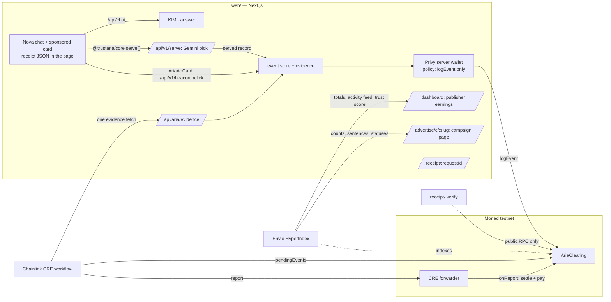

# Aria Clearing

**Clearing for sponsored AI answers: every sponsored line has a receipt, verified by Chainlink, settled on Monad.**

AI apps have large free tiers and no way to earn from them. Aria lets an independent AI app show a disclosed,
sponsored recommendation inside an answer when the user has buying intent. Aria Clearing is the trust and
settlement layer underneath: it turns each sponsored line into a public receipt anyone can verify from Monad
alone, and it pays the app only after a Chainlink CRE workflow has checked the evidence.

Track: **Trust, Identity & AI Infrastructure** (Metropolis hackathon).

- Contract (Monad testnet, source verified): [`0x431e97E2EB23ac06C9f807cC8DCe54499C1bDC7B`](https://testnet.monadvision.com/address/0x431e97E2EB23ac06C9f807cC8DCe54499C1bDC7B)
- Live app: https://web-production-95cf9.up.railway.app (demo overview at `/`, Nova at `/ai-chat`, publisher dashboard at `/dashboard`, advertiser console at `/advertise`)
- Indexer (Envio Cloud, GraphQL): https://indexer.dev.hyperindex.xyz/eca926f/v1/graphql
- Demo video: _link added at submission_

## The receipt

Every sponsored line moves through one lifecycle, and every step is on Monad:

```
issued (card rendered) → logged (impression / click) → verified · paid   or   rejected / disputed → refunded
```

A receipt binds three things together:

1. **The exact sentence the AI showed.** It is emitted in `EventLogged`; the contract hashes it itself.
2. **The advertiser's approved claims.** They are emitted in `CampaignCreated` with their hash; the sentence cites
   them by number, and the receipt page highlights the cited ones.
3. **The money.** The price is reserved from the advertiser's escrow when the event is logged and paid to the
   app when the event is verified.

Nova also embeds the receipt in the page, beside the card, so any extension, crawler or other app can find it:

```html
<script type="application/json" data-aria-receipt>
  {"chainId":10143,"contract":"0x…","requestId":"req_…","campaignId":"0x…","claimsHash":"0x…","rationaleHash":"0x…"}
</script>
```

The embedded `rationaleHash` is computed from the sentence the card renders, before anything is logged. Its
"Why this ad?" link carries the same values, `/receipt/<requestId>?h=<rationaleHash>&c=<claimsHash>`, so the
receipt page can say whether the sentence you saw is the one logged on Monad.

### Hash recipe

| Value | Definition |
|---|---|
| `claims` | the approved claims as one UTF-8 string: numbered lines `1. …`, one per line, no trailing newline |
| `rationale` | the exact string the card renders: trimmed, Unicode NFC |
| `claimsHash` | `keccak256(utf8(claims))` |
| `rationaleHash` | `keccak256(utf8(rationale))` |
| `requestKey` | `keccak256(utf8(requestId))` (indexed topic, so a verifier can find the event) |
| `eventId` | `keccak256(abi.encode(string requestId, uint8 kind))`, kind 0 = impression, 1 = click |
| `campaignId` | `keccak256(utf8(slug))` |

The same recipe is implemented once in TypeScript (`receipt/src/hash.ts`) and checked byte for byte against
Foundry's `cast` in the tests.

### Verify a receipt yourself

No Aria server is involved; it reads the contract over a public RPC and takes a few seconds whatever the age of
the event:

```bash
pnpm install
pnpm --filter @aria-clearing/receipt verify req_36wX7fR79VnTOVHwllgYhA \
  --sentence "For a Lisbon family trip, packages cover 3 to 10 nights and children under 6 stay free."
# ✓ publisher amount + Aria fee = price
#     paid  $0.2000 to 0x6743…72cb · Aria fee $0.0500 (20 %)
# ✓ The sentence you saw is the one that was logged and paid for
```

The check that matters is the one against what you saw. Pass either or both:

- `--sentence "<text you saw>"`: hashed with the recipe above (trimmed, NFC) and compared with the logged
  `rationaleHash`. Change one word and the first line becomes `✗ Mismatch: rationaleHash differs from what was logged`.
- `--receipt '<data-aria-receipt JSON>'`: the card's `chainId`, `contract`, `campaignId`, `claimsHash` and
  `rationaleHash` are each compared with what was logged; the first line names any field that differs.

It then recomputes the event id, the sentence hash and the claims hash from the logs and compares them with the
contract's own state. The contract computes those hashes itself when it logs, so this part only shows the logged
record is internally consistent; it passes for any logged event. Last comes the lifecycle with transaction hashes.
Exit code 0 = no mismatch, 1 = mismatch, 2 = not found or bad arguments. The receipt page at `/receipt/<requestId>`
runs the same comparison with the `h` and `c` values from the card's link; opened without them, it says so and
shows only what was logged.

## How settlement works

1. **Escrow.** An advertiser funds a campaign in USDC; `createCampaign` stores the claims hash and emits the
   claims text.
2. **Logging.** When the card has been at least 50 % visible for 1 s, or is clicked through Aria's redirect,
   Aria's relayer calls `logEvent`. The relayer is a **Privy server wallet** whose **Privy policy** allows exactly
   one call: `logEvent` on this contract, on Monad testnet. It cannot move money.
3. **Dispute window.** The advertiser can `dispute(eventId)` while the window is open. The window is set at deploy:
   20 s in the demo, so logged → verified → paid fits on screen; in production it would be hours to days, long
   enough for the advertiser's fraud tooling to review events, and still far faster than ad-network payment terms.
4. **Verification.** A **Chainlink CRE workflow** reads all pending events in one call, fetches their evidence in
   one HTTP request, applies the rule (impression: viewed ≥ 1 s at ≥ 50 %; click: went through the redirect),
   and writes one report through the CRE forwarder (the mock forwarder on Monad testnet) to `onReport`.
5. **Payout.** In the same transaction, released events pay the app's account directly (`PaidOut`); rejected
   and disputed events return to the advertiser's budget. Aria's fee is taken only here, on verified events:
   20 % of the price, fixed when the contract is deployed (the constructor refuses more than 30 %). The app
   receives the rest, both amounts are in `PaidOut`, and `verify` checks that they add up to the price. Fees
   accrue in the contract; `withdrawFees()` can be called by anyone and always pays Aria's fee address.
   Aria pays all gas: the app never signs, claims or holds gas tokens. If a transfer ever fails, the amount
   waits as credit (`PayoutDeferred`) and `claim()` pays it out; that fallback is the one path where the app's
   account needs gas.

The wallet that logs events cannot release funds; only a report through the forwarder can, and only after a
window the contract enforces. The forwarder address itself is set by the contract owner (Aria).

### The Privy policies

Both of Aria's server wallets are Privy server wallets owned by an authorization key, each with a deny-by-default
policy on Monad testnet (`eip155:10143`):

| Wallet | Allowed, everything else denied |
|---|---|
| Relayer (logs events) | `eth_sendTransaction` to AriaClearing whose calldata function is `logEvent` |
| Advertiser treasury (console campaigns) | USDC `approve` with spender = AriaClearing; AriaClearing `createCampaign`, `dispute`, `withdraw` |

A request outside the policy never reaches the chain. This is the response when the relayer tries to send
0.001 MON to the publisher (the "Relayer tries to pay" control), or the treasury tries a USDC `transfer`:

```json
HTTP 400 {"error":"RPC request denied due to policy violation","code":"policy_violation"}
```

Rules: `ops/src/policy.ts`. Probes: `pnpm --filter @aria-clearing/ops privy:probe` and `privy:treasury-probe`.

### What is verified — and what is not

| Verified before money moves | Not verified |
|---|---|
| The event was logged once, by the relayer (contract) | That a human saw the card |
| Impressions met the viewability rule in the evidence | That the evidence endpoint tells the truth: it is Aria's |
| Clicks went through Aria's redirect | Independent parties: every key is Aria's in this demo |
| The relayer cannot pay anyone (contract roles + Privy policy) | Decentralised execution: the workflow runs in CRE simulation, and the Monad testnet mock forwarder is permissionless |
| The sentence you pass (`--sentence`, `--receipt`, or the card's `?h=` link) equals the one logged for that request | Without that input, only that the logged record is internally consistent: the contract hashes what it logs |
| | That the sentence is a faithful reading of the claims: an LLM wrote it, citing claim numbers |
| | That the ad choice is production-grade: the serve API's selector is a single Gemini call (keywords as fallback), not Aria's production classifier and auction |
| The dispute window passed without a dispute | That viewability was measured honestly: the app's page measures it and reports it; the workflow checks the rule, not the measurement |
| | Settlement routing: the owner can change the forwarder, and with the permissionless mock forwarder anyone could post a far-future `reportedAt` and stall later reports |
| | Fair disputes: in the demo a dispute is a free advertiser veto and is always refunded; production needs a bond or an arbiter, and automated disputes by the advertiser's fraud tooling |

Next steps toward production: a second, independent evidence source (advertiser conversion postbacks); per-epoch
Merkle roots instead of one transaction per event; a deployed DON with the production forwarder.

## Advertisers

`/advertise` is a minimal campaign console modelled on Google Ads, for brands that know nothing about crypto:
sign in with email, paste your website (**Read my website**: the server fetches the page, https only and never
private addresses, and KIMI drafts the brand, a description, 3–5 factual claims, a category and topics), approve
the claims (the exact text that goes onchain), pick a budget and CPC/CPM bids, and launch. Describing the product
by hand works too. The campaign page shows spend, remaining budget,
impressions, clicks, CTR, rejections by reason, the latest sponsored sentences with their status and receipt,
Dispute and End campaign. Counts and sentences come from the Envio indexer and cover the campaign's whole history;
the money comes from contract state. When the indexer is unreachable, or has not yet processed the campaign's
creation, the page reads the last ~2 hours of contract logs instead and says so.

**Wallet-funded campaigns** (`ADVERTISER_FUNDING=wallet`, the live site). The advertiser's own Privy embedded
wallet, created at email sign-in, is the onchain advertiser. **Fund and launch** shows the wallet's address and
its USDC and MON next to what the launch needs; **Launch** has the wallet approve the exact budget (skipped when
the allowance covers it) and call `createCampaign`, each behind Privy's confirmation prompt, so the brand's own
USDC moves into escrow. The server builds the call, keeps the campaign pending, and makes it live only after it
reads the receipt: one `CampaignCreated` log from AriaClearing whose advertiser is the caller's embedded wallet
(looked up server-side from the Privy user id, never taken from the browser) and whose claims hash, prices and
budget match what was prepared. Dispute and End campaign are signed by the same wallet and checked the same way.
Gas is paid in MON with explicit limits (estimate + 20 %), since Monad charges the full limit.

On this test network, **Add test funds** sends the budget in test USDC and enough MON for the launch, a few
disputes and End from Aria's deployer key (once per account by default, `ARIA_TEST_FUNDS_PER_USER`, and within
`ARIA_LAUNCH_MAX_USD`; the demo key skips both). It stands in for an onramp: in production an onramp provider funds
this wallet from a card payment, and the top-up step disappears for the brand.

**Treasury fallback** (`ADVERTISER_FUNDING=treasury`, the default). Funding is honest test funding: "This is a
test network. No card is charged." Aria's treasury server wallet is the onchain advertiser and acts for the brand
(custodial, test mode); launching is one `createCampaign` transaction that moves the budget into escrow.

Either way, a new campaign joins the list Aria's serve API picks from as soon as it is live.

## How it uses Monad

- **One transaction per impression and click is affordable**, so every sponsored line gets its own onchain
  receipt rather than a batch entry.
- **~400 ms blocks and ~800 ms finality** make the lifecycle visible live: a receipt goes from logged to paid in
  the time of a 20-second dispute window plus one settlement transaction.
- **Native USDC** for escrow and payouts (`0x534b2f3A21130d7a60830c2Df862319e593943A3` on testnet).
- Monad-specific details handled in code: gas is charged on the gas limit, so limits are measured and set
  tightly; the relayer sends one transaction at a time; `eth_getLogs` is limited to 100 blocks, so the verifier
  locates events from contract state and a timestamp search instead of scanning history.

## Architecture



| Folder | What it is |
|---|---|
| `contracts/` | `AriaClearing.sol` (escrow, event log, disputes, CRE consumer, payouts), Foundry tests, deploy and seed scripts |
| `receipt/` | the hash recipe, the ABI, `verifyReceipt()` and the `verify` CLI; depends on viem only |
| `cre/` | the `aria-settle` Chainlink CRE workflow (TypeScript SDK) with its tests |
| `indexer/` | Envio HyperIndex: campaigns, event lifecycle with each sponsored sentence, and a per-publisher trust score; serves the dashboard's totals, activity feed and trust score, and the campaign page's counts and sentences |
| `ops/` | Privy server wallets (relayer, advertiser treasury), their policies, probes and `sendFromWallet()` |
| `web/` | Nova (the reference AI app, a publisher using `@trustaria/core` and `@trustaria/react`), Aria's API routes including the serve API and the impression beacon, the receipt page, the publisher dashboard and the advertiser console |
| `deployments/` | `10143.json`: the live contract address and deploy block |

## Technology

Monad testnet · Solidity 0.8.28 + Foundry · OpenZeppelin · Chainlink CRE (TypeScript SDK, `cre` CLI) · Privy
(server wallets, policies, email login with embedded wallets) · Envio HyperIndex (dashboard totals, activity feed,
trust score; campaign page counts and sentences) · KIMI (`kimi-k2.6`, Moonshot
AI) · Gemini (Flash, through its OpenAI-compatible API) · `@trustaria/core` and `@trustaria/react` (Aria's publisher SDK) · Next.js 14 +
React 18 · viem · USDC.

## Run it

Requirements: Node ≥ 22.15, pnpm 10, Foundry ≥ 1.8, bun ≥ 1.2.21 and the `cre` CLI (for settlement), Docker (for
the indexer).

```bash
git clone --recurse-submodules <this repo>   # contracts/lib are git submodules
pnpm install
cp .env.example .env.local      # fill in the values; `pnpm env:check` lists what is missing
pnpm dev                        # http://localhost:3000 — demo overview; /ai-chat (Nova); /dashboard; /advertise; /receipt/<requestId>
```

**With no secrets at all** you can still: run every test suite; `verify` any receipt from the public RPC; and
`pnpm dev` to open receipt pages and Nova on its clearly labelled stub model (the stub runs in dev only, never
under `next start`), with cards picked by keyword under a built-in dev key. Logging events and the dashboards need a
Privy app (`NEXT_PUBLIC_PRIVY_APP_ID`, `PRIVY_APP_SECRET`, an authorization key); real answers need
`KIMI_API_KEY`; cards under `next start` need `ARIA_API_KEY` and `ARIA_TOKEN_SECRET`; Gemini picks need
`GEMINI_API_KEY`; settlement needs `cre login` and a funded key; the indexer needs Docker and `ENVIO_API_TOKEN`.

**How Nova gets its ad.** Nova is a publisher: its chat route calls Aria's serve API through Aria's publisher SDK,
`@trustaria/core` (`createAria(...).serve({ prompt, context, sessionId })`), at the same time as it starts its own
answer. The serve API (`POST /api/v1/serve`, Bearer `ARIA_API_KEY`) picks at most one live campaign independently
of the answer, records the served sentence for the clearing, and answers with the ad (or a typed no-fill); Nova
re-validates it against the campaign's claims and shows the card after the answer. A no-fill, a timeout (Nova's
budget is `ARIA_SERVE_TIMEOUT_MS`, default 6 s) or an error only means no card. By default Nova calls its own
server (`ARIA_BASE_URL` points it elsewhere); set `ARIA_PUBLIC_URL` to the public origin so the ad's click, why and
beacon URLs are absolute public links (the card follows them as served, so a deployed server needs it).

**The card.** Nova renders the served ad with `@trustaria/react`'s `AriaAdCard` (blockquote style, the whole card
clickable) and puts the receipt JSON beside it. The impression is measured in the browser: at least 50 % of the
card visible for one continuous second, with the tab and the "Sponsored" disclosure visible. The card then
beacons it straight to Aria's `POST /api/v1/beacon` with the ad's signed, single-use impression token (an HMAC
under `ARIA_TOKEN_SECRET`); Aria checks the token against the served record and logs the impression onchain with
the measured dwell and visible ratio as its evidence. A billable click is the card's link through Aria's redirect,
`/api/aria/click/<requestId>`; the card also posts each click to Nova's `/api/aria/card-events`, which forwards it
to Aria's `POST /api/v1/events` as a signal that is not billed.

**Gemini.** The serve API picks with one Gemini call (`GEMINI_MODEL`, default `gemini-3.6-flash`, minimal
thinking, JSON output, 4 s timeout): the campaign, 1–2 claim numbers and one sentence built from them. Without
`GEMINI_API_KEY`, or when the call fails or times out, it picks by campaign keywords instead. `pnpm --filter
@aria-clearing/web eval:select` runs the selector against a fixed question set.

**KIMI.** Nova's answers run on `kimi-k2.6` with thinking disabled, so replies start in about a second; KIMI also
drafts claims in the advertiser console. A built-in limiter queues every KIMI call to fit low rate-limit accounts
(defaults: 3 requests per minute, 1 at a time; raise `KIMI_RPM` and `KIMI_CONCURRENCY` on a higher tier).

**Single-tenant demo server.** The web app holds the relayer's and the seed advertiser's credentials and exposes
demo controls (forge, dispute, publisher registration) without access control. Run it on your own machine; do not
host it publicly as is.

Settle pending events (after the dispute window):

```bash
cd cre && cre login
cre workflow simulate ./aria-settle -T staging-settings --non-interactive --trigger-index 0 --broadcast
```

The mock forwarder never reverts the outer transaction, so confirm settlement with the contract's
`EventSettled` / `PaidOut` logs or with `verify`, not with the simulator's status line.

Run the indexer (Envio HyperIndex, Docker; the dashboard's totals, full activity feed and trust score, the
campaign page's full history, and the trust score on the receipt page):

```bash
pnpm --filter @aria-clearing/indexer sync-config   # address + start block from deployments/10143.json
pnpm --filter @aria-clearing/indexer docker:up
pnpm --filter @aria-clearing/indexer start         # GraphQL on http://localhost:8080/v1/graphql
```

If ports 8080/5433 are taken, set `HASURA_EXTERNAL_PORT`, `ENVIO_PG_PORT` and `HASURA_GRAPHQL_ENDPOINT` before
starting, and point `ENVIO_GRAPHQL_URL` at the new port. When the indexer is down the dashboard reads totals and
activity, and the campaign page its counts and sentences, from the last ~2 hours of contract logs instead; the
dashboard hides the trust score. Each page names its source under Account details ("Indexed by Envio HyperIndex"
or "Read from contract logs"). A schema change needs a full resync:
`pnpm --filter @aria-clearing/indexer resync`.

Deploy your own copy: see `contracts/README.md` (deploy, Sourcify verification, seed) and
`pnpm --filter @aria-clearing/ops privy:relayer` / `privy:policy` for the relayer.

Tests: `pnpm test` (receipt, indexer, ops, web; the indexer needs Node ≥ 22.15), `cd contracts && forge test`,
`cd cre/aria-settle && bun test`.

## Demo controls

`/ai-chat?debug=1` (or Ctrl+Shift+D) opens a debug bar; when `ARIA_DEMO_KEY` is set, as on the live site, only
`/ai-chat?debug=<ARIA_DEMO_KEY>` opens it (`/?debug=…` redirects there). It has **Forge impression** (an impression posted for a card that was
never seen, as a dishonest publisher backend could), **Dispute** (the advertiser disputes an event) and
**Relayer tries to pay** (shows the Privy policy denial). Tick **Hold views** before forging, otherwise the
card is viewed as soon as it appears; a held card sends its beacon to a sink that records nothing.

## Existing code

- Starting point: the official Monad template
  [`next-serwist-privy-embedded-wallet`](https://github.com/monad-developers/next-serwist-privy-embedded-wallet)
  (Next.js + Privy embedded wallet on Monad testnet).
- `@trustaria/core`: Aria's publisher SDK, MIT, © 2026 Evermore Labs Co. Used as a dependency
  ([`@trustaria/core` on npm](https://www.npmjs.com/package/@trustaria/core)), not modified here.
- `@trustaria/react`: Aria's React card for publishers (`AriaAdCard`, the events handler), MIT, © 2026 Evermore
  Labs Co. Used as a dependency ([`@trustaria/react` on npm](https://www.npmjs.com/package/@trustaria/react)), not modified here.

Everything else in this repository was written for this hackathon.

## Credits
- Libraries: OpenZeppelin Contracts, forge-std, viem, `@chainlink/cre-sdk`, `@privy-io/react-auth`,
  `@privy-io/node`, Envio, Next.js. The advertisers in the demo are fictional.
- This project was built with the help of AI coding tools (Claude Code), as allowed by the hackathon rules: parallel
  coding agents worked in separate git worktrees and their commits were merged onto `main`, which is why some
  commits share timestamps.

## License

MIT — see `LICENSE`.
