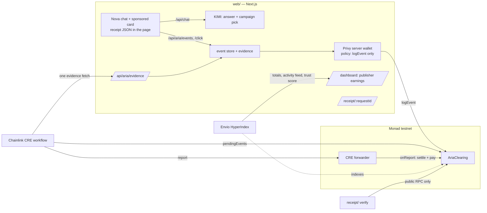

# Aria Clearing

**Clearing for sponsored AI answers: every sponsored line has a receipt, verified by Chainlink, settled on Monad.**

AI apps have large free tiers and no way to earn from them. Aria lets an independent AI app show a disclosed,
sponsored recommendation inside an answer when the user has buying intent. Aria Clearing is the trust and
settlement layer underneath: it turns each sponsored line into a public receipt anyone can verify from Monad
alone, and it pays the app only after a Chainlink CRE workflow has checked the evidence.

Track: **Trust, Identity & AI Infrastructure** (Metropolis hackathon).

- Contract (Monad testnet, source verified): [`0xfb6bA8e6c48c806AFC40aFee5F85deE42Ce8F2fb`](https://testnet.monadvision.com/address/0xfb6bA8e6c48c806AFC40aFee5F85deE42Ce8F2fb)
- Demo video: _link added at submission_

## The receipt

Every sponsored line moves through one lifecycle, and every step is on Monad:

```
issued (card rendered) → logged (impression / click) → verified · paid   or   rejected / disputed → refunded
```

A receipt binds three things together:

1. **The exact sentence the AI showed.** It is emitted in `EventLogged`; the contract hashes it itself.
2. **The advertiser's approved claims.** They are emitted in `CampaignCreated` with their hash; the sentence cites
   them by number, and the receipt page highlights the cited ones.
3. **The money.** The price is reserved from the advertiser's escrow when the event is logged and paid to the
   app when the event is verified.

The card also embeds the receipt in the page, so any extension, crawler or other app can find it:

```html
<script type="application/json" data-aria-receipt>
  {"chainId":10143,"contract":"0x…","requestId":"req_…","campaignId":"0x…","claimsHash":"0x…","rationaleHash":"0x…"}
</script>
```

The embedded `rationaleHash` is computed from the sentence the card renders, before anything is logged. Its
"Why this ad?" link carries the same values, `/receipt/<requestId>?h=<rationaleHash>&c=<claimsHash>`, so the
receipt page can say whether the sentence you saw is the one logged on Monad.

### Hash recipe

| Value | Definition |
|---|---|
| `claims` | the approved claims as one UTF-8 string: numbered lines `1. …`, one per line, no trailing newline |
| `rationale` | the exact string the card renders: trimmed, Unicode NFC |
| `claimsHash` | `keccak256(utf8(claims))` |
| `rationaleHash` | `keccak256(utf8(rationale))` |
| `requestKey` | `keccak256(utf8(requestId))` (indexed topic, so a verifier can find the event) |
| `eventId` | `keccak256(abi.encode(string requestId, uint8 kind))`, kind 0 = impression, 1 = click |
| `campaignId` | `keccak256(utf8(slug))` |

The same recipe is implemented once in TypeScript (`receipt/src/hash.ts`) and checked byte for byte against
Foundry's `cast` in the tests.

### Verify a receipt yourself

No Aria server is involved; it reads the contract over a public RPC and takes a few seconds whatever the age of
the event:

```bash
pnpm install
pnpm --filter @aria-clearing/receipt verify req_payout1791832698
pnpm --filter @aria-clearing/receipt verify req_bqJymQAubWx7q03A1zA2FD \
  --sentence "Family packages for Lisbon and the Algarve, 3 to 10 nights. Children under 6 stay free in partner hotels."
# ✓ The sentence you saw is the one that was logged and paid for
```

The check that matters is the one against what you saw. Pass either or both:

- `--sentence "<text you saw>"`: hashed with the recipe above (trimmed, NFC) and compared with the logged
  `rationaleHash`. Change one word and the first line becomes `✗ Mismatch: rationaleHash differs from what was logged`.
- `--receipt '<data-aria-receipt JSON>'`: the card's `chainId`, `contract`, `campaignId`, `claimsHash` and
  `rationaleHash` are each compared with what was logged; the first line names any field that differs.

It then recomputes the event id, the sentence hash and the claims hash from the logs and compares them with the
contract's own state. The contract computes those hashes itself when it logs, so this part only shows the logged
record is internally consistent; it passes for any logged event. Last comes the lifecycle with transaction hashes.
Exit code 0 = no mismatch, 1 = mismatch, 2 = not found or bad arguments. The receipt page at `/receipt/<requestId>`
runs the same comparison with the `h` and `c` values from the card's link; opened without them, it says so and
shows only what was logged.

## How settlement works

1. **Escrow.** An advertiser funds a campaign in USDC; `createCampaign` stores the claims hash and emits the
   claims text.
2. **Logging.** When the card has been at least 50 % visible for 1 s, or is clicked through Aria's redirect,
   Aria's relayer calls `logEvent`. The relayer is a **Privy server wallet** whose **Privy policy** allows exactly
   one call: `logEvent` on this contract, on Monad testnet. It cannot move money.
3. **Dispute window.** The advertiser can `dispute(eventId)` while the window is open (20 s in the demo).
4. **Verification.** A **Chainlink CRE workflow** reads all pending events in one call, fetches their evidence in
   one HTTP request, applies the rule (impression: viewed ≥ 1 s at ≥ 50 %; click: went through the redirect),
   and writes one report through the Chainlink forwarder to `onReport`.
5. **Payout.** In the same transaction, released events pay the app's account directly (`PaidOut`); rejected
   and disputed events return to the advertiser's budget. Aria pays all gas: the app never signs, claims or
   holds gas tokens. If a transfer ever fails, the amount waits as credit (`PayoutDeferred`) and `claim()` pays
   it out.

The wallet that logs events cannot release funds; only a report through the forwarder can, and only after a
window the contract enforces.

### What is verified — and what is not

| Verified before money moves | Not verified |
|---|---|
| The event was logged once, by the relayer (contract) | That a human saw the card |
| Impressions met the viewability rule in the evidence | That the evidence endpoint tells the truth: it is Aria's |
| Clicks went through Aria's redirect | Independent parties: every key is Aria's in this demo |
| The relayer cannot pay anyone (contract roles + Privy policy) | Decentralised execution: the workflow runs in CRE simulation, and the Monad testnet mock forwarder is permissionless |
| The sentence you pass (`--sentence`, `--receipt`, or the card's `?h=` link) equals the one logged for that request | Without that input, only that the logged record is internally consistent: the contract hashes what it logs |
| | That the sentence is a faithful reading of the claims: an LLM wrote it, citing claim numbers |
| The dispute window passed without a dispute | |

Next steps toward production: a second, independent evidence source (advertiser conversion postbacks); per-epoch
Merkle roots instead of one transaction per event; a deployed DON with the production forwarder.

## How it uses Monad

- **One transaction per impression and click is affordable**, so every sponsored line gets its own onchain
  receipt rather than a batch entry.
- **~400 ms blocks and ~800 ms finality** make the lifecycle visible live: a receipt goes from logged to paid in
  the time of a 20-second dispute window plus one settlement transaction.
- **Native USDC** for escrow and payouts (`0x534b2f3A21130d7a60830c2Df862319e593943A3` on testnet).
- Monad-specific details handled in code: gas is charged on the gas limit, so limits are measured and set
  tightly; the relayer sends one transaction at a time; `eth_getLogs` is limited to 100 blocks, so the verifier
  locates events from contract state and a timestamp search instead of scanning history.

## Architecture



| Folder | What it is |
|---|---|
| `contracts/` | `AriaClearing.sol` (escrow, event log, disputes, CRE consumer, payouts), Foundry tests, deploy and seed scripts |
| `receipt/` | the hash recipe, the ABI, `verifyReceipt()` and the `verify` CLI; depends on viem only |
| `cre/` | the `aria-settle` Chainlink CRE workflow (TypeScript SDK) with its tests |
| `indexer/` | Envio HyperIndex: campaigns, event lifecycle and a per-publisher trust score; serves the dashboard's totals, activity feed and trust score |
| `ops/` | Privy relayer and policy scripts, and `sendFromRelayer()` |
| `web/` | Nova (the reference AI app), Aria's API routes, the receipt page and the publisher dashboard |
| `deployments/` | `10143.json`: the live contract address and deploy block |

## Technology

Monad testnet · Solidity 0.8.28 + Foundry · OpenZeppelin · Chainlink CRE (TypeScript SDK, `cre` CLI) · Privy
(server wallets, policies, email login with embedded wallets) · Envio HyperIndex (dashboard totals, activity feed,
trust score) · KIMI (`kimi-k2.6`, Moonshot
AI) · Next.js 14 + React 18 · viem · USDC.

## Run it

Requirements: Node ≥ 22.15, pnpm 10, Foundry ≥ 1.8, bun ≥ 1.2.21 and the `cre` CLI (for settlement), Docker (for
the indexer).

```bash
pnpm install
cp .env.example .env.local      # fill in the values; `pnpm env:check` lists what is missing
pnpm dev                        # http://localhost:3000 — Nova; /dashboard; /receipt/<requestId>
```

Without `KIMI_API_KEY` Nova uses a clearly labelled stub model so the rest can be tried offline.

Settle pending events (after the dispute window):

```bash
cd cre && cre login
cre workflow simulate ./aria-settle -T staging-settings --non-interactive --trigger-index 0 --broadcast
```

The mock forwarder never reverts the outer transaction, so confirm settlement with the contract's
`EventSettled` / `PaidOut` logs or with `verify`, not with the simulator's status line.

Run the indexer (Envio HyperIndex, Docker; the dashboard's totals, full activity feed and trust score, and the
trust score on the receipt page):

```bash
pnpm --filter @aria-clearing/indexer sync-config   # address + start block from deployments/10143.json
pnpm --filter @aria-clearing/indexer docker:up
pnpm --filter @aria-clearing/indexer start         # GraphQL on http://localhost:8080/v1/graphql
```

If ports 8080/5433 are taken, set `HASURA_EXTERNAL_PORT`, `ENVIO_PG_PORT` and `HASURA_GRAPHQL_ENDPOINT` before
starting, and point `ENVIO_GRAPHQL_URL` at the new port. When the indexer is down the dashboard reads totals and
activity from the last ~2 hours of contract logs instead and hides the trust score.

Deploy your own copy: see `contracts/README.md` (deploy, Sourcify verification, seed) and
`pnpm --filter @aria-clearing/ops privy:relayer` / `privy:policy` for the relayer.

Tests: `pnpm test` (receipt, ops, web), `cd contracts && forge test`, `cd cre/aria-settle && bun test`.

## Demo controls

`/?debug=1` (or Ctrl+Shift+D) opens a debug bar: **Forge impression** (an impression posted for a card that was
never seen, as a dishonest publisher backend could), **Dispute** (the advertiser disputes an event) and
**Relayer tries to pay** (shows the Privy policy denial). Tick **Hold views** before forging, otherwise the
card is viewed as soon as it appears.

## Credits

- Starting point: the official Monad template
  [`next-serwist-privy-embedded-wallet`](https://github.com/monad-developers/next-serwist-privy-embedded-wallet)
  (Next.js + Privy embedded wallet on Monad testnet). Everything else in this repository was written during the
  hackathon.
- Libraries: OpenZeppelin Contracts, forge-std, viem, `@chainlink/cre-sdk`, `@privy-io/react-auth`,
  `@privy-io/node`, Envio, Next.js. The advertisers in the demo are fictional.
- This project was built with the help of AI coding tools (Claude Code), as allowed by the hackathon rules.

## License

MIT — see `LICENSE`.
